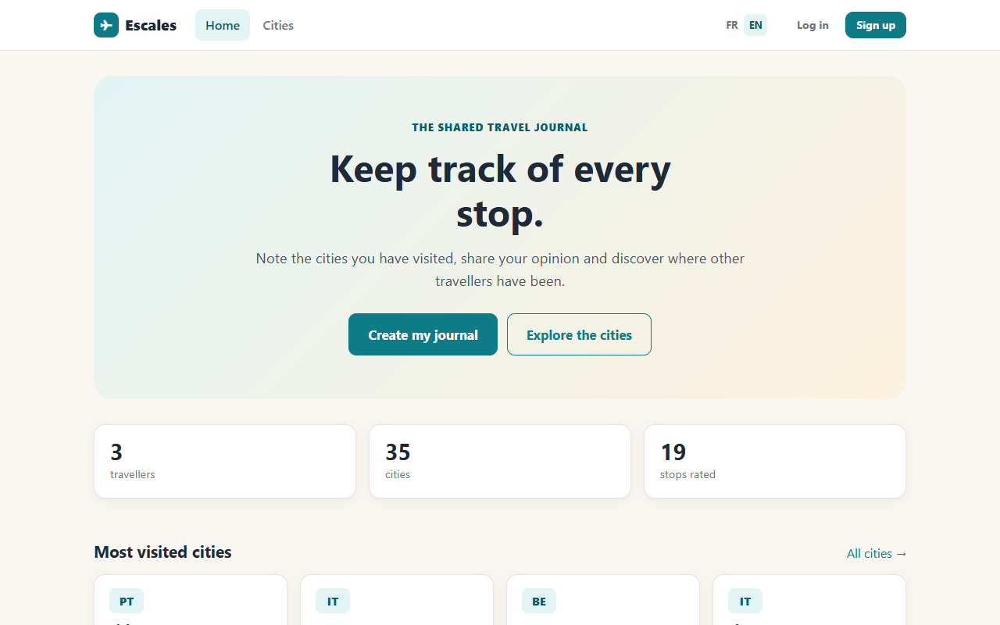
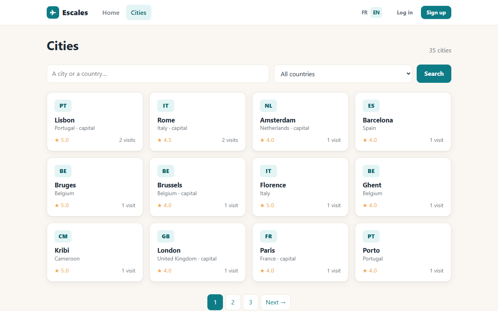
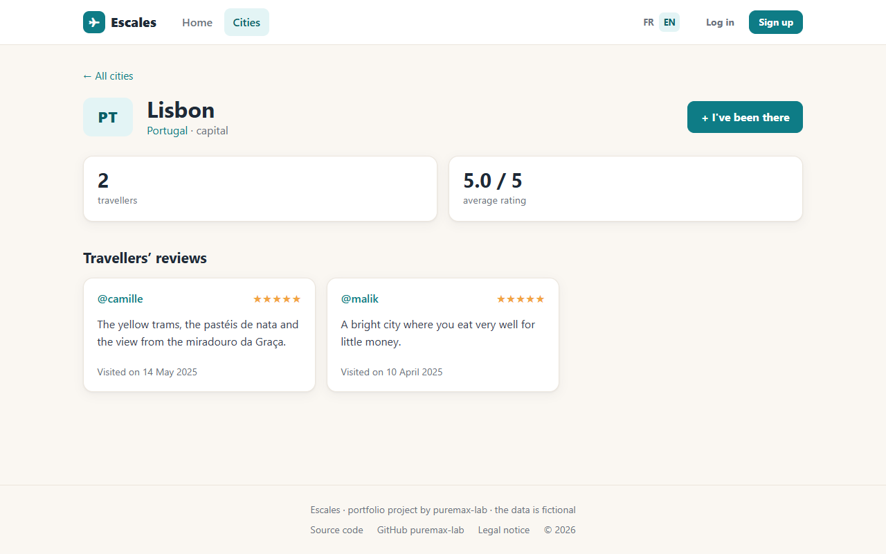
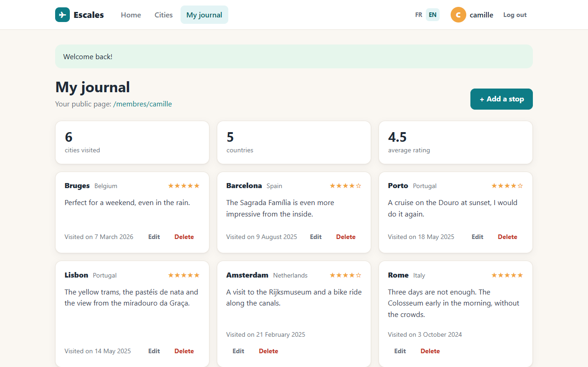
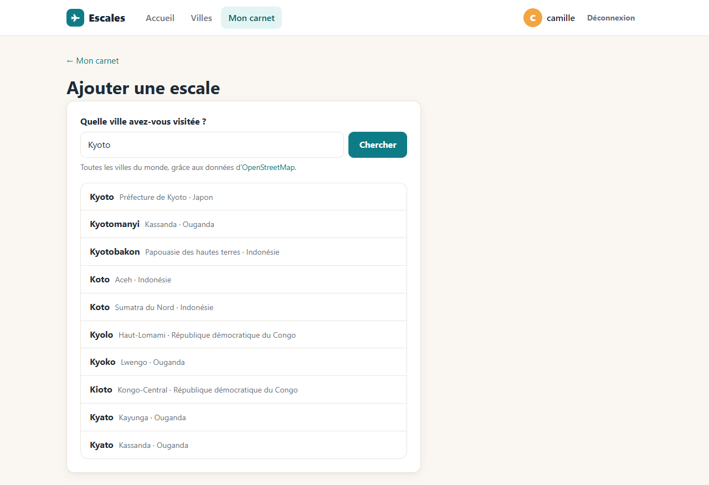
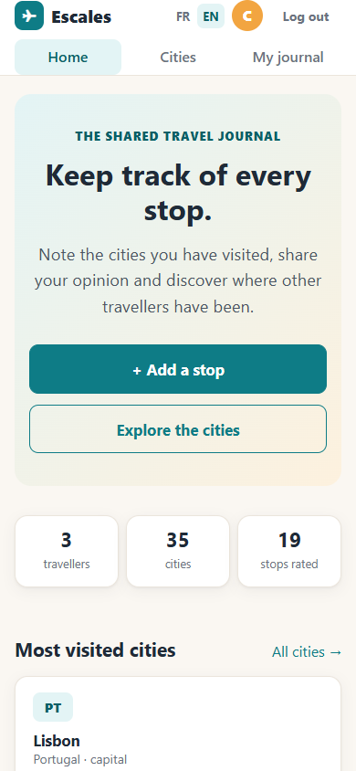
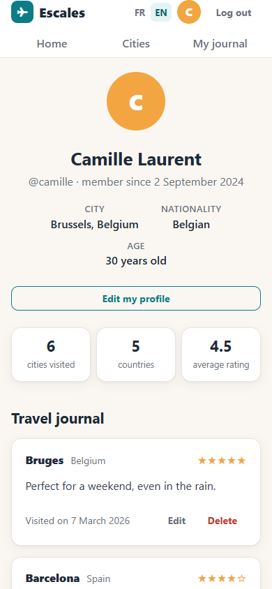
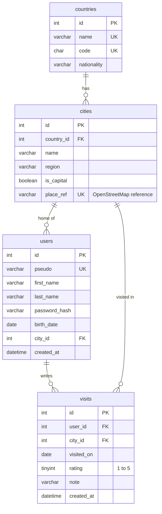

# Escales

**A travel journal web app written in plain PHP, with no framework.**
*Carnet de voyage partagé, développé en PHP natif, sans framework.*

### 👉 [Try the live demo](https://puremax-lab.alwaysdata.net/escales)

Log in with **camille** / **password** (other demo accounts: `malik`, `lena`, same password), or create your own account. The site is in French by default: click **EN** in the header for English.


[](https://github.com/puremax-lab/Escales/actions/workflows/tests.yml)



## Why plain PHP?

Frameworks like Symfony handle routing, security and forms for you. I built Escales without one to show I understand what happens underneath: every request, query and form check is my own code. My Symfony project, [RecetteVie](https://github.com/puremax-lab/RecetteVie), shows the other side.

The app itself is a shared travel journal: visitors search cities and read reviews, members note the cities they have visited and get a public profile page.

## What I wrote myself

**The core of a framework**
- **Front controller** ([`public/index.php`](public/index.php)): every request goes through one file.
- **Router** ([`Router`](src/Core/Router.php)) with URL parameters such as `/villes/{id}`, and 404 / 405 answers.
- **MVC**: controllers in [`src/Controller`](src/Controller), SQL in repositories ([`src/Repository`](src/Repository)), HTML in PHP templates ([`templates`](templates)) rendered inside a shared layout.
- **Composer** for PSR-4 autoloading and PHPUnit only: no runtime dependency.
- **Two languages, without a library** ([`Lang`](src/Core/Lang.php), [`lang/en.php`](lang/en.php)): French is the source text, and a `t()` helper replaces it with its English version. The FR / EN switch is a plain link, so it works with no JavaScript: `/langue/en?retour=…` keeps the choice in the session and goes back to the page, and only ever to a path of this site.
- **Works in a sub-folder** (online at `/escales`): the request finds its base path, and links, redirects and the session cookie follow it through a `url()` helper.

**Web security, by hand**
- **SQL injection**: every query that contains user input is a PDO prepared statement (the others are fixed SQL with no variables).
- **XSS**: all text coming from users or the database is escaped with `e()` (`htmlspecialchars`) before being printed.
- **CSRF**: a token per session, checked on every POST.
- **Passwords**: hashed with `password_hash`, re-hashed when PHP's algorithm changes, never stored in the session.
- **Login**: session id regenerated after login, generic error message, and a **login throttle** stored in the database (5 failures in 15 minutes for the same pseudo and IP address).
- **Access control**: a member can only edit or delete their own entries; others get a 404.
- Session cookies `HttpOnly` and `SameSite=Lax`, and security headers (`X-Frame-Options`, `X-Content-Type-Options`).

**Data and validation**
- **Server-side validation** ([`Validator`](src/Core/Validator.php)): required fields, lengths, real dates, unique pseudo, rating 1 to 5. The form keeps the typed values and shows an error under each field.
- **Database constraints**: foreign keys, unique keys (one entry per city per member), a `CHECK` on the rating, and journal entries deleted with their member.

**An external API, without a library**
- **Every city in the world**: the journal searches [Photon](https://photon.komoot.io), a geocoder built on OpenStreetMap data, with names in French ([`PhotonPlaceFinder`](src/Places/PhotonPlaceFinder.php)). A plain `file_get_contents` with a timeout, no SDK.
- **Trust nothing from the browser**: the form only sends the place reference; the server looks the city up again before saving it, so a made-up city is refused.
- **No JavaScript**: in the sign-up and profile forms, "Chercher" sends the form again and lists the cities to tick, keeping what was typed.
- **Saved on first use**: a city enters the database the first time a member notes it, with its country if it is new, and is shared by everyone after that.
- **Works when the service is down**: the search still shows the cities already in Escales, with a message.

## The app

- **Cities**: search by city or country, filter by country, pagination (1, 2, 3… with previous / next, shortened when there are many pages), page per city with reviews and average rating
- **Journal**: add any city in the world you have visited (search, pick, rate), edit and delete entries, with a date, a 1 to 5 star rating and a review
- **Members**: sign-up with a home city anywhere in the world, login, logout, public profile with statistics (cities, countries, average rating), profile editing
- **Home page**: key figures, most visited cities, latest reviews
- **French and English**: the interface, form errors, dates, the legal notice, and the demo countries, cities and reviews, with the language kept for the whole visit and after logging out. An English city name also works in the search (`brussels` finds Bruxelles)
- **Legal notice**: publisher, host and the personal data the site keeps

| Cities | City page |
|---|---|
|  |  |

| My journal | Adding a city from anywhere in the world |
|---|---|
|  |  |

| Mobile: home | Mobile: profile |
|---|---|
|  |  |

## Good to know

The screenshots show the English version. What a member writes stays in the language it was written in. Cities added from the world search keep their French name from Photon, because they are stored once and shared by everyone. The URLs stay in French (`/villes`, `/carnet`).

## The database



- A member lives in one city, and their nationality comes from that city's country (known for the demo countries).
- A city added from the world search keeps its OpenStreetMap reference (`place_ref`, unique): two members who note it share one row, and two towns with the same name in one country stay apart.
- A member has at most one journal entry per city (`UNIQUE (user_id, city_id)`).
- A `login_attempts` table, not linked to the others, stores failed logins for the throttle.

## Quality and stack

- **83 PHPUnit tests**: unit tests for the router, validator, CSRF and sub-folder handling, and functional tests that send real requests through the whole app (sign-up, login, throttle, journal, world city search with a fake search service, permissions, escaping, language switch). One test reads the code and fails if a text has no English version.
- **GitHub Actions** runs the tests on PHP 8.3 and 8.4 at every push.

**Stack:** PHP 8.3+ (no framework), MySQL or SQLite, HTML and CSS with no library and no JavaScript (100% server-rendered PHP), PHPUnit 12, GitHub Actions. Online on alwaysdata (SQLite), served from a sub-folder.

## Run it locally

**Requirements:** PHP 8.3+ with the `mbstring` extension and `pdo_sqlite` or `pdo_mysql`, and [Composer](https://getcomposer.org).

**Quick start with SQLite (no database server needed):**

```bash
git clone https://github.com/puremax-lab/Escales.git
cd Escales
composer install
php bin/setup.php --sqlite
composer serve
```

`setup.php --sqlite` creates the database with the demo data and writes `config/config.local.php`. Open http://127.0.0.1:8000 and log in with **camille** / **password** (other demo accounts: `malik`, `lena`, same password).

**With MySQL:** create an empty `escales` database, copy `config/config.local.php.dist` to `config/config.local.php` with your credentials, then run `php bin/setup.php`.

**Upgrading a database created before the world city search:** run `database/migrations/2026-11-world-cities.sqlite.sql` (or `.mysql.sql`) once.

**Run the tests:**

```bash
composer test
```

## Author

**puremax-lab**: [github.com/puremax-lab](https://github.com/puremax-lab)

## Credits

City names and places © [OpenStreetMap contributors](https://www.openstreetmap.org/copyright) (ODbL), searched through [Photon](https://photon.komoot.io) by komoot.
