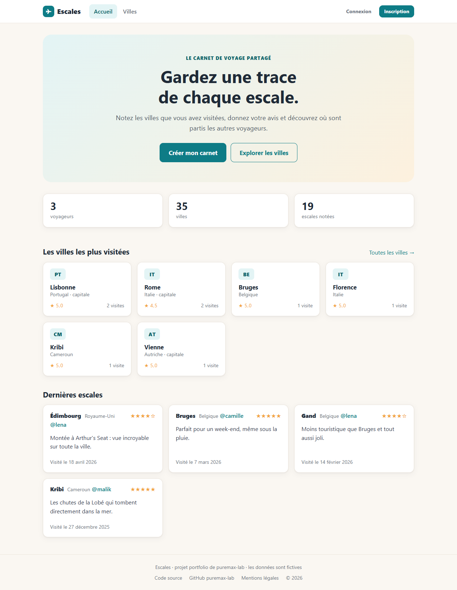
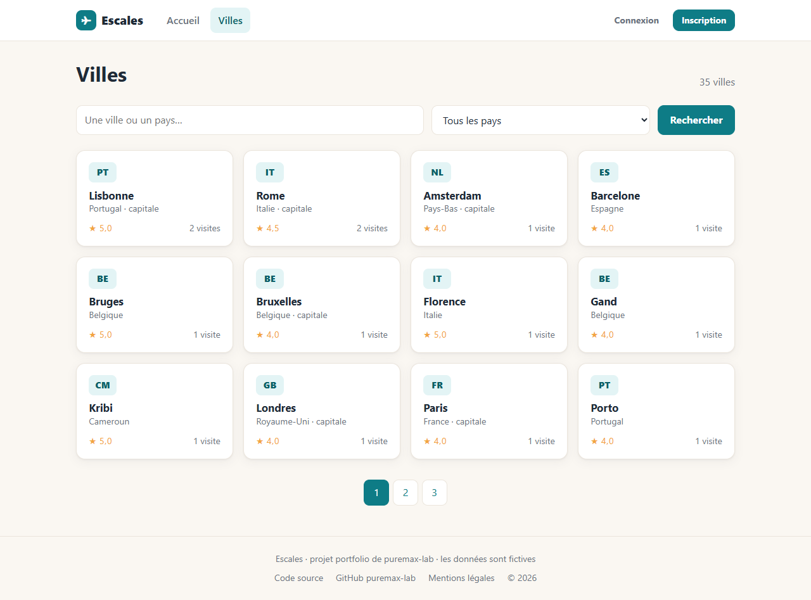
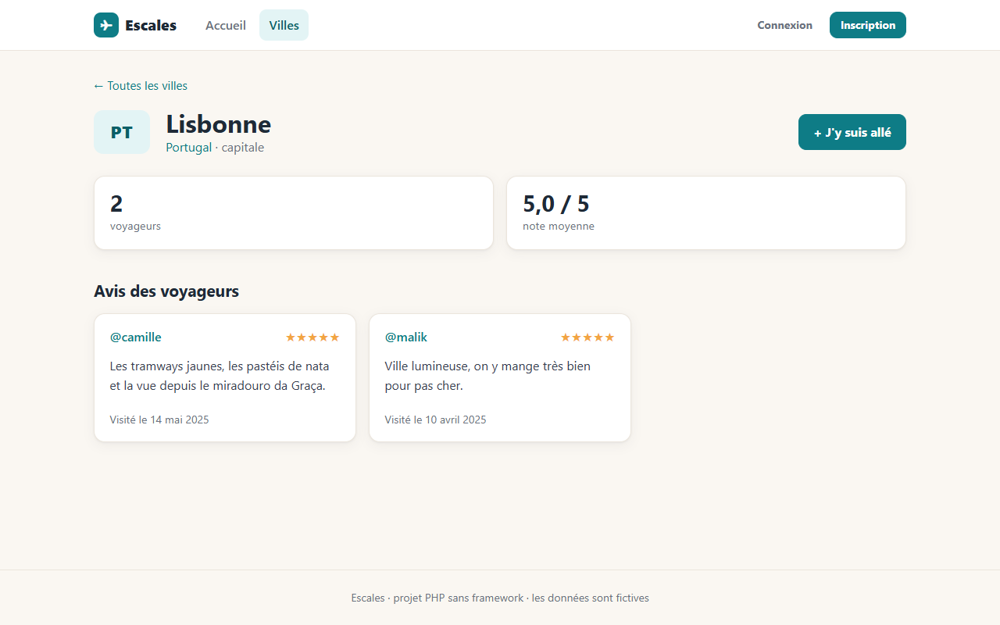
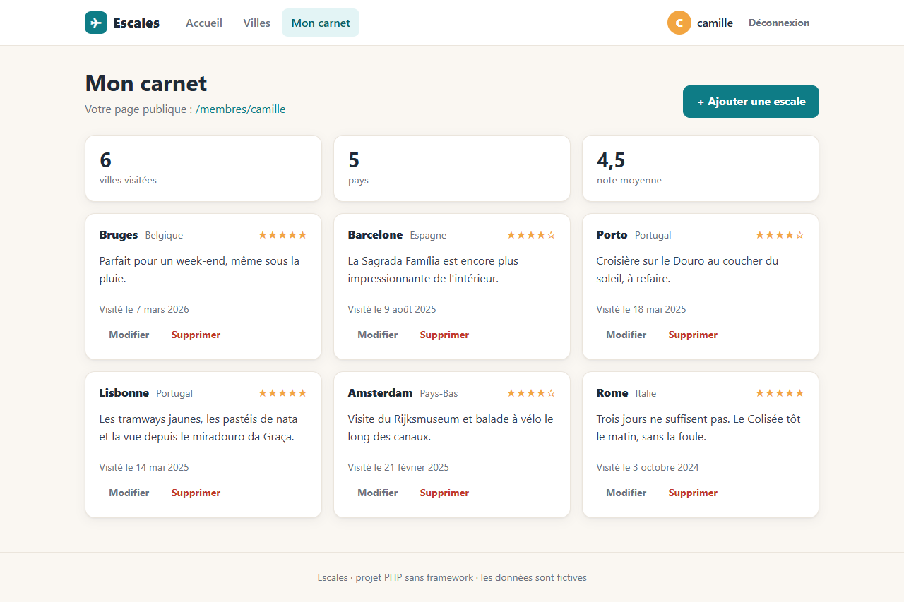
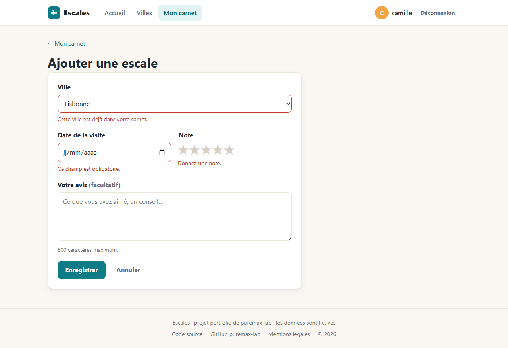
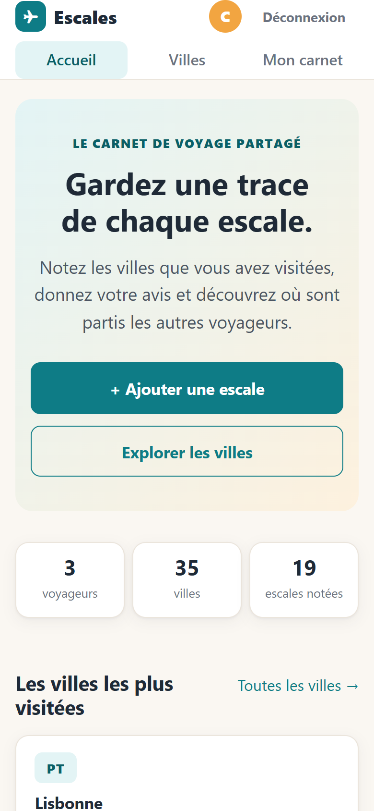
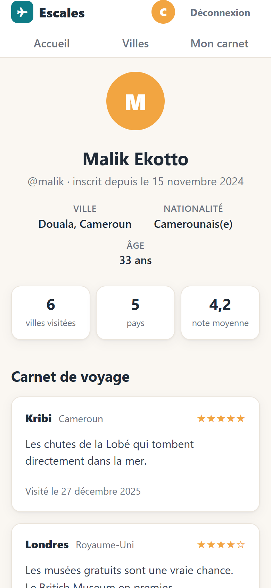
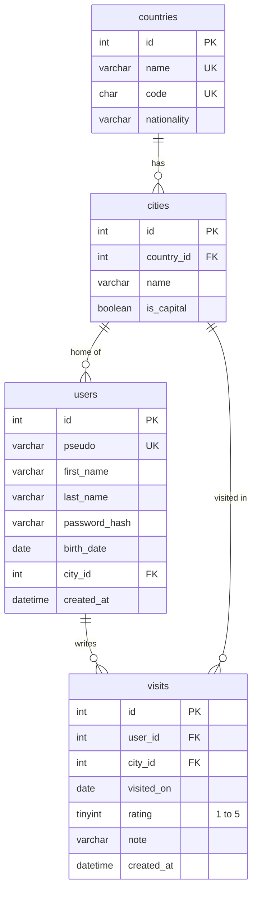

# Escales

**A travel journal web app written in plain PHP, with no framework.**
*Carnet de voyage partagé, développé en PHP natif, sans framework.*

### 👉 [Try the live demo](https://puremax-lab.alwaysdata.net/escales)

Log in with **camille** / **password** (other demo accounts: `malik`, `lena`, same password), or create your own account.


[](https://github.com/puremax-lab/Escales/actions/workflows/tests.yml)



## Why plain PHP?

Frameworks like Symfony handle routing, security and forms for you. I built Escales without one to show I understand what happens underneath: every request, query and form check is my own code. My Symfony project, [RecetteVie](https://github.com/puremax-lab/RecetteVie), shows the other side.

The app itself is a shared travel journal: visitors search cities and read reviews, members note the cities they have visited and get a public profile page.

## What I wrote myself

**The core of a framework**
- **Front controller** ([`public/index.php`](public/index.php)): every request goes through one file.
- **Router** ([`Router`](src/Core/Router.php)) with URL parameters such as `/villes/{id}`, and 404 / 405 answers.
- **MVC**: controllers in [`src/Controller`](src/Controller), SQL in repositories ([`src/Repository`](src/Repository)), HTML in PHP templates ([`templates`](templates)) rendered inside a shared layout.
- **Composer** for PSR-4 autoloading and PHPUnit only: no runtime dependency.
- **Works in a sub-folder** (online at `/escales`): the request finds its base path, and links, redirects and the session cookie follow it through a `url()` helper.

**Web security, by hand**
- **SQL injection**: every query that contains user input is a PDO prepared statement (the others are fixed SQL with no variables).
- **XSS**: all text coming from users or the database is escaped with `e()` (`htmlspecialchars`) before being printed.
- **CSRF**: a token per session, checked on every POST.
- **Passwords**: hashed with `password_hash`, re-hashed when PHP's algorithm changes, never stored in the session.
- **Login**: session id regenerated after login, generic error message, and a **login throttle** stored in the database (5 failures in 15 minutes for the same pseudo and IP address).
- **Access control**: a member can only edit or delete their own entries; others get a 404.
- Session cookies `HttpOnly` and `SameSite=Lax`, and security headers (`X-Frame-Options`, `X-Content-Type-Options`).

**Data and validation**
- **Server-side validation** ([`Validator`](src/Core/Validator.php)): required fields, lengths, real dates, unique pseudo, rating 1 to 5. The form keeps the typed values and shows an error under each field.
- **Database constraints**: foreign keys, unique keys (one entry per city per member), a `CHECK` on the rating, and journal entries deleted with their member.

## The app

- **Cities**: search by city or country, filter by country, pagination, page per city with reviews and average rating
- **Journal**: add, edit and delete the cities you have visited, with a date, a 1 to 5 star rating and a review
- **Members**: sign-up, login, logout, public profile with statistics (cities, countries, average rating), profile editing
- **Home page**: key figures, most visited cities, latest reviews
- **Legal notice**: publisher, host and the personal data the site keeps

| Cities | City page |
|---|---|
|  |  |

| My journal | Form validation |
|---|---|
|  |  |

| Mobile: home | Mobile: profile |
|---|---|
|  |  |

## The database



- A member lives in one city, and their nationality comes from that city's country.
- A member has at most one journal entry per city (`UNIQUE (user_id, city_id)`).
- A `login_attempts` table, not linked to the others, stores failed logins for the throttle.

## Quality and stack

- **PHPUnit tests**: unit tests for the router, validator, CSRF and sub-folder handling, and functional tests that send real requests through the whole app (sign-up, login, throttle, journal, permissions, escaping).
- **GitHub Actions** runs the tests on PHP 8.3 and 8.4 at every push.

**Stack:** PHP 8.3+ (no framework), MySQL or SQLite, HTML and CSS with no library and no JavaScript, PHPUnit 12, GitHub Actions. Online on alwaysdata (SQLite), served from a sub-folder.

## Run it locally

**Requirements:** PHP 8.3+ with the `mbstring` extension and `pdo_sqlite` or `pdo_mysql`, and [Composer](https://getcomposer.org).

**Quick start with SQLite (no database server needed):**

```bash
git clone https://github.com/puremax-lab/Escales.git
cd Escales
composer install
php bin/setup.php --sqlite
composer serve
```

`setup.php --sqlite` creates the database with the demo data and writes `config/config.local.php`. Open http://127.0.0.1:8000 and log in with **camille** / **password** (other demo accounts: `malik`, `lena`, same password).

**With MySQL:** create an empty `escales` database, copy `config/config.local.php.dist` to `config/config.local.php` with your credentials, then run `php bin/setup.php`.

**Run the tests:**

```bash
composer test
```

## Author

**puremax-lab**: [github.com/puremax-lab](https://github.com/puremax-lab)
